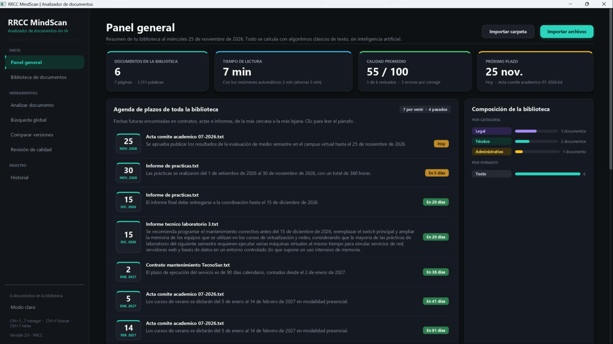

# RRCC MindScan

**Analizador de documentos para Windows sin inteligencia artificial.** Resume, responde preguntas, extrae datos, busca, compara versiones, detecta texto copiado y revisa la calidad de documentos PDF, Word y de texto, todo dentro de tu computadora y sin internet.

Autor: **Rodrigo Russel Chura Chailña** · Universidad Peruana Unión · 2026



## Descargar e instalar

1. Ve a **[Releases](../../releases/latest)** y descarga `RRCCMindScan-Instalador-v2.0.exe`.
2. Haz doble clic y sigue el asistente: **Siguiente → Acepto el acuerdo → Siguiente → Siguiente → Instalar → Finalizar**.
3. Abre el programa con el acceso directo **RRCC MindScan** del escritorio.

No necesitas instalar Java: el instalador ya lo incluye. Requisitos: Windows 10 u 11 de 64 bits, 4 GB de RAM y 300 MB libres.

## Funciones

| Módulo | Qué hace | Algoritmo |
|---|---|---|
| Panel general | Indicadores, agenda de plazos encontrada en los documentos, estado de cada documento y mapa de similitud | Expresiones regulares, coseno |
| Biblioteca | Importa PDF, DOCX y TXT (también carpetas completas), detecta duplicados y clasifica cada documento | SHA-256, conteo de términos |
| Analizar documento | Resumen, preguntas al documento, palabras clave, datos extraídos, cronología, personas y estadísticas | TextRank, BM25, TF-IDF, regex, Fernández-Huerta |
| Búsqueda global | Busca en todos los documentos aunque escribas mal la palabra | BM25, Levenshtein |
| Comparar versiones | Cambios oración por oración, vista lado a lado y texto idéntico compartido | LCS, coseno, Jaccard, n-gramas |
| Revisión de calidad | Puntaje de 0 a 100 con 10 reglas, errores subrayados en el texto y corrección automática | Reglas, similitud coseno |
| Historial | Evolución del puntaje y comparaciones guardadas | — |

Exporta los resultados a Word y Excel.

## Ejecutar desde el código

Requisitos: **JDK 17** o superior.

```bat
cd rrcc-mindscan
.\mvnw.cmd javafx:run
```

En Visual Studio Code también puedes usar **Terminal → Run Build Task** (Ctrl+Shift+B).

Pruebas automáticas (17):

```bat
.\mvnw.cmd test
```

## Generar el .exe y el instalador

| Script | Resultado |
|---|---|
| `RRCC-GENERAR-EXE.bat` | `RRCC-EXE\RRCCMindScan\RRCCMindScan.exe` con Java incluido (jlink + jpackage) |
| `RRCC-GENERAR-INSTALADOR.bat` | `RRCC-INSTALADOR\RRCCMindScan-Instalador-v2.0.exe` con asistente (Inno Setup) |

## Tecnologías

Java 17 · Spring Boot 3.3 · JavaFX 21 · AtlantaFX · SQLite · Hibernate · Apache PDFBox · Apache POI · Lombok · JUnit 5

## Estructura

```
RRCC-MindScan/
├── rrcc-mindscan/                 código fuente (Maven)
│   └── src/main/java/com/ejemplo/rrccmindscan/
│       ├── config/  exception/  model/  repository/
│       ├── service/                algoritmos de texto
│       ├── controller/             pantallas
│       └── ui/                     componentes visuales
├── Documentacion/                 código fuente, manual de uso y para ejecutar
├── RRCC-GENERAR-EXE.bat
├── RRCC-GENERAR-INSTALADOR.bat
├── RRCC-INSTALADOR.iss
├── LICENCIA.txt
└── LEEME.txt
```

## Licencia

Copyright © 2026 Rodrigo Russel Chura Chailña. Todos los derechos reservados. Consulta [LICENCIA.txt](LICENCIA.txt).
